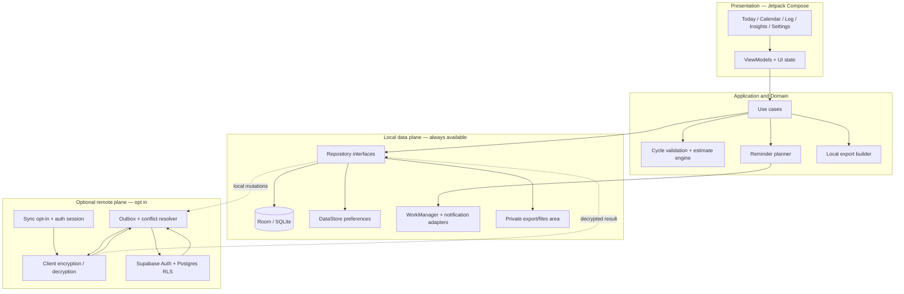

# 01 — Target System Architecture

## 1. Goals

CycleCare should be a dependable Android-first cycle-tracking app that is fast, usable offline, transparent about estimates, and conservative with reproductive-health data. Cloud services must be optional and should not be necessary for core use.

### Architecture decisions

- **Local-first:** Room is the operational source of truth on each device.
- **Derived data stays derived:** predictions and insights are computed from observed records and preferences. They are not written back as confirmed events.
- **Optional cloud sync:** Supabase Auth/Postgres is used only after explicit user opt-in.
- **Encryption before upload:** health payloads are encrypted on-device before entering Supabase. RLS protects row ownership but is not a substitute for client encryption.
- **No cloud ML for core predictions:** deterministic, versioned local domain logic is preferred for explainability and offline use.
- **Platform-native UI:** Jetpack Compose and Android behavior remain primary; Apple HIG principles inform interaction quality, not iOS cloning.

## 2. Logical architecture

The UI never calls Supabase directly. It observes repository state. The sync engine operates as an adapter around local repositories and does not become a second, competing source of truth.

## 3. Runtime data flow

### Local entry (no network required)

1. A user records period start/end or a daily log.
2. The use case validates the input and writes it to Room in a transaction.
3. Room emits the updated state through a Flow.
4. ViewModels derive screen state; the domain layer recomputes relevant estimates and insights.
5. The reminder planner reconciles scheduled work from current records and preferences.
6. If sync is enabled, a durable outbox entry is created in the same local transaction as the user mutation.

### Optional sync

1. User opens Settings → Privacy & data → Sync and reads a plain-language disclosure.
2. The app explains what metadata the service can still observe and how key recovery works.
3. User signs in and enables sync.
4. The local vault key is unlocked; each record payload is encrypted client-side.
5. The sync worker uploads encrypted envelopes using the authenticated session.
6. Supabase RLS restricts rows to the authenticated owner. The client does not contain a service-role secret.
7. Downloaded envelopes are verified and decrypted on-device before repository merge.
8. Conflicts are surfaced or deterministically merged only when the data type permits a safe merge.

The user must be able to pause sync, continue logging offline, see the last successful sync time, retry errors, and disable sync without losing local data.

## 4. Module boundaries

**The Gradle graph has now been verified** (`./gradlew projects`). The current repository has 16 modules:

| Module | Type | Role | Audit note |
|---|---|---|---|
| `:app` | application | Startup, `AppContainer` composition, navigation host, ads, reminders, app lock | **Violations live here** — `CycleCareApp.kt:147-160` and `AppLockGate.kt` mutate state from composable scope. All 10 feature screens are correctly hoisted. |
| `:core:model` | kotlin.jvm | Immutable models and enums | **Zero tests.** Contains the `PredictionSnapshot.confidenceLabel: String` that `11` replaces. |
| `:core:domain` | kotlin.jvm | Validation, prediction, insights, reminder planning | **Strongest suite in the repo** — 36 tests. No ambient clock permitted (`11` §3). |
| `:core:data` | android.library | Repository implementations, DataStore, export, mapping | Zero unit tests; 8 instrumented tests pass. |
| `:core:database` | android.library | Room entities, DAOs, migrations | 5 entities at v2, no indices, no FKs, no audit columns. `migration1To2` has **zero coverage** and one existing test is broken (`00` §3.7). |
| `:core:designsystem` | android.library | Theme, tokens, components | **Zero tests.** 4 of 15 type roles, no `Shapes()`, unused spacing object. Specified in `14`. |
| `:core:testing` | kotlin.jvm | Shared fixtures | **Orphaned** — declared in `settings.gradle.kts:30`, depended on by nothing. Either adopt it or delete it. |
| `:feature:*` | android.library × 8 | Screen ViewModels, navigation, composables | `feature:billing` is **deleted from source but not from disk** and is not in `settings.gradle.kts`. Clean up its `build/` artefacts. |
| `:benchmark` | android.test | Macrobenchmark | **The test never compiles** — source is in `src/androidTest` of a `com.android.test` module with all non-`benchmark` variants disabled (`benchmark/build.gradle.kts:35-39`). Verified: no `compileBenchmarkAndroidTestKotlin` task exists. |

Because a whole-app rewrite is permitted, the conceptual split below still holds, with one addition:

| Boundary | Responsibility | Must not own |
|---|---|---|
| `:app` | Startup, DI/composition, navigation host, ads, notifications, app lock | Cycle algorithm logic or direct SQL from screens |
| `:core:model` | Immutable domain models and stable enums | Android framework dependencies where avoidable |
| `:core:domain` | Validation, prediction, insights, reminder and notification scoring, use-case contracts | Room, Supabase, Compose APIs |
| `:core:database` | Room entities, DAOs, migrations, schema export | UI presentation state |
| `:core:data` | Repository implementations, mapping, outbox/sync orchestration, export | Ad hoc UI-specific SQL |
| `:core:security` | Vault/key interface, encryption envelope, secure deletion coordination | UI policy decisions or logging of plaintext records |
| `:core:designsystem` | Compose theme tokens, typography, reusable components | Product-domain rules |
| `:feature:*` | Screen ViewModels, navigation, composables, UI tests | Direct Supabase service-role access |
| `:core:testing` | Fixtures, fake clocks, fake repositories, shared rules | Production dependencies |

**Decision on `:core:security`:** create it. It is the only clean home for the vault key lifecycle (`17`), the PIN KDF replacement, and the removal of cryptographic concerns currently inlined in `feature:privacy` and `core:data`.

Two structural cleanups to make before feature work begins: **adopt `:core:testing`** as the home of the fake clock that `11` §3, `12` §8 and `13` §15 all depend on, or **delete it** and place those fixtures elsewhere. Leaving an orphan module declared in the build is not acceptable.

Avoid premature modularization. Split features where it improves compile-time boundaries, ownership, testing or build times—not to achieve a target module count.

## 5. Dependency rules

- `feature` → `domain/model/designsystem`.
- `data` → `domain/model/database/security`.
- `database` → `model` (or dedicated persistence models if domain and database schemas must diverge).
- `domain` → `model` and Kotlin/JDK abstractions only.
- `app` wires implementations together.
- Supabase adapters must be replaceable behind repository/sync interfaces.
- Compose code must not calculate cycle lengths, fertility estimates, or sync conflict decisions.

## 6. Source-of-truth rules

| Data | Source of truth | Sync? | Notes |
|---|---|---|---|
| Confirmed period/cycle records | Room on current device | Yes, only if opted in | Remote copy is a backup/sync replica, not the UI's live authority |
| Daily symptom/mood logs | Room | Yes, only if opted in | Sensitive payload encrypted before upload |
| Prediction snapshots | Derived in domain layer | Prefer recompute; optionally cache locally | Never convert a prediction into an observed event |
| User preferences | DataStore or Room according to transaction needs | Only needed preferences | Don't sync device-specific permissions/notification grants |
| Reminder rules | Local persistence | Usually device-specific | Cross-device rules may be added later; schedules must be recomputed on each device |
| Reminder events/delivery IDs | Local | No by default | Avoid cross-device notification duplication |
| App lock and local key handles | Android Keystore / secure local state | Never upload secret key material unwrapped | Device-specific |
| Exported reports | User-controlled local file | No by default | Never silently upload or share |
| Analytics | Minimal, explicit allowlist | Optional aggregate telemetry only | Never include notes, symptoms, dates, predictions or free text |

## 7. Background work and reminders

- Use WorkManager for deferrable tasks: refreshing the schedule, retrying sync, cleanup, and outbox processing.
- Do not promise a notification at an exact minute when the scheduler does not guarantee it.
- If exact timing is a product requirement, separately assess AlarmManager exact-alarm permissions, current Android policy, battery behavior, and store requirements before committing to it.
- Use unique work and idempotent jobs. Repeated boot/time-zone/app-update events must not create duplicate reminders.
- Store delivery state in a local repository. A worker posts a system notification when the app is backgrounded. The foreground UI observes the persisted event and may show a subtle, in-app update.
- Mask reproductive-health wording on the lock screen by default; allow the user to opt in to more detailed previews.
- Notification permission must be requested in context, after the user enables a reminder—not blindly on launch.

See [Apple notification principles](https://developer.apple.com/design/human-interface-guidelines/notifications/) for the general principle of concise, useful, non-sensitive notification copy; adapt system-specific details to Android.

## 8. Reliability and performance requirements

Initial targets (verify on representative low/mid-range devices; adjust from measurements):

- Core Today and Calendar screens render from local state and remain useful in airplane mode.
- No screen blocks on network availability for ordinary logging or browsing.
- No health record is lost because sync is unavailable.
- Repeated sync of the same mutation is idempotent.
- Database migrations preserve all valid user-entered records.
- Cold start, scrolling, and recomposition are measured with Macrobenchmark/Compose tooling rather than assigned a score without evidence.
- App state is restored safely after process death; UI ViewModels are not treated as durable storage.

## 9. Observability boundaries

- Record only operational errors that can be diagnosed without cycle content.
- Never log free-text notes, symptom values, period dates, decrypted payloads, vault keys, PINs, access tokens, or export contents.
- Use stable, non-health-specific error categories (`sync_timeout`, `db_migration_failed`, `notification_schedule_failed`).
- Keep diagnostics opt-in where feasible and expose a user-readable explanation of data collected.
- Ensure an exception message from a third-party SDK cannot accidentally include request bodies or sensitive query parameters.

## 10. Architecture decision record (ADR)

**ADR-001: local-first with opt-in encrypted sync**  
**Status:** Recommended; requires explicit product approval.  
**Context:** Moving all storage to Supabase would simplify account-level synchronization but would contradict the existing zero-cloud premise and make app availability depend on the network. Raw cloud health data also increases exposure if credentials, policies or operators are compromised.  
**Decision:** Room remains the local source of truth; Supabase is an optional transport/storage replica for encrypted records.  
**Consequences:** More complicated key recovery, encryption, migration and conflict handling; no server-side insight querying; better separation between offline use and cloud services.  
**Alternatives rejected:** (a) Supabase as the only database—reject for core app flows; (b) plaintext cloud records protected only by RLS—simpler but weaker privacy properties and requires a different, explicit product promise.
