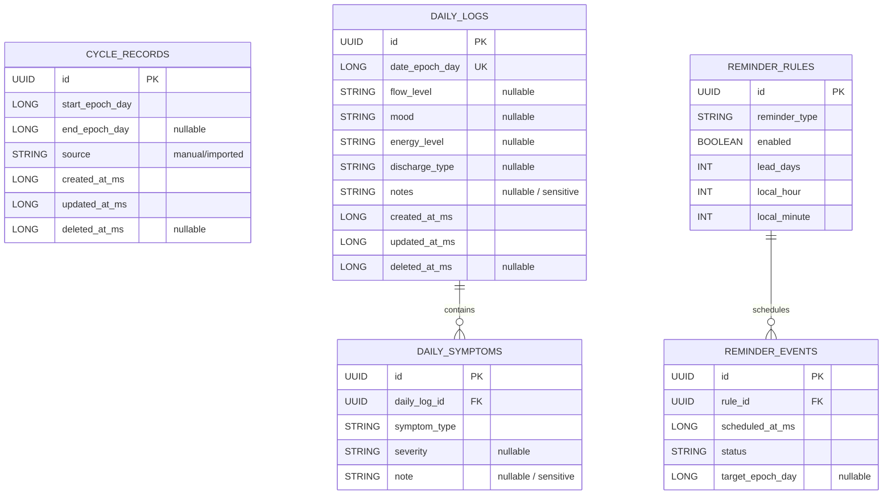

# 02 — Database Model, Migrations, and Cloud Sync

## 1. Database principles

1. **Persist observations, not guesses.** Confirmed user-entered records and derived estimates must remain distinct.
2. **Use date-only semantics for cycle dates.** A period date is a calendar date in the user's context, not a UTC instant. In Room, a `LocalDate` can be persisted as an epoch-day `Long`; in Postgres, use `date` inside the encrypted payload or an actual `date` only if plaintext sync is intentionally chosen.
3. **Use stable UUID identifiers.** IDs must survive local migrations and be stable across devices. Do not derive IDs from date or symptom content.
4. **Make deletes syncable.** A local deletion must enqueue a tombstone so a previously synced record is not re-imported on another device.
5. **Keep remote metadata minimal.** For encrypted sync, the server needs an owner and opaque record identity, not a queryable table of symptom names, cycle dates, medications or notes.
6. **Migrations are versioned and tested.** No destructive fallback migration is allowed for production user data without an explicit user-confirmed export/reset decision.

## 2. Recommended logical entities



The diagram intentionally does not draw a foreign key from a cycle record to a daily log. A daily log belongs to a date; cycle phase can be derived from the nearest confirmed cycle start. Add an explicit cycle identifier only if the product has a clear requirement that remains correct when cycle dates are edited.

## 3. Local Room tables

### `CycleRecordEntity`

Suggested fields:

- `id: String` — UUID.
- `startEpochDay: Long` — required.
- `endEpochDay: Long?` — nullable while a period is ongoing or if the end was not recorded.
- `source: CycleRecordSource` — `MANUAL` or `IMPORTED` only for confirmed observations.
- `createdAtEpochMillis`, `updatedAtEpochMillis` — audit metadata.
- `deletedAtEpochMillis: Long?` — tombstone only if local/remote sync needs recoverable deletes.

Validation rules:

- `endEpochDay == null || endEpochDay >= startEpochDay`.
- A record cannot be silently overwritten by a prediction.
- Duplicate starts should be rejected or resolved through an explicit merge flow.
- Overlapping confirmed period ranges should trigger a correction prompt. Do not silently choose one.
- Imported data must pass the same validation as manually entered data.

### `DailyLogEntity`

Suggested fields include `id`, unique `dateEpochDay`, optional flow, mood, energy, discharge category, notes, timestamps, and deletion metadata. Keep each field nullable if leaving it blank is a valid user choice. Do not create empty rows merely because the calendar screen was opened.

Free-text notes are especially sensitive. Treat them as user content: never put them in analytics, crash logs, notification text, debug messages, or query parameters.

### `DailySymptomEntity`

Each selected symptom is a child row keyed to a daily log. Use a stable enum/code for known categories, with display labels localized separately. If severity is supported, define a scale and labels explicitly. If users can add custom symptoms, store the display text as sensitive data and restrict where it may flow.

### `ReminderRuleEntity` and `ReminderEventEntity`

Rules are preferences, such as whether a reminder is enabled and its local time. Events capture an attempted/posted reminder and support idempotency and diagnostics. Device-specific OS permission state is not a cloud preference. Persist the rule, then reconcile it with Android's actual notification permission and channel settings.

Store scheduled instants as epoch milliseconds for actual delivery timing and target cycle dates as epoch days. On timezone change, recompute schedules from local-time preferences rather than replaying old UTC instants blindly.

### Derived prediction cache

A cache is optional. If persisted, include `algorithmVersion`, input fingerprint or last-updated marker, generated time, estimated date/range, and confidence/uncertainty label. Treat it as disposable and recomputable. Do not reuse an old cache after a migration or algorithm change without validation.

### DataStore

Use DataStore for non-relational preferences that do not need atomic joins with log records. Do not store keys, PINs, access tokens, or raw health record exports in ordinary preferences. Do not use preferences as a substitute for a database when update ordering/transactions matter.

## 4. Supabase remote schema: encrypted envelope pattern

### Why not mirror the local tables as plaintext by default?

A conventional schema (`cycle_records.start_date`, `symptom_logs.mood`, `medication`, `notes`) makes those values readable to roles or operators with database access, even if RLS prevents other users from reading them. RLS is authorization, not end-to-end encryption.

For the recommended privacy posture, use an opaque table such as `vault_sync_records`:

| Field | Type | Purpose / exposure |
|---|---|---|
| `user_id` | `uuid` | Owner, references `auth.users(id)`; visible to database authorization |
| `record_id` | `uuid` | Random stable logical record ID |
| `schema_version` | `smallint` | Envelope/payload version for safe decryption and migration |
| `key_version` | `smallint` | Identifies the vault key version, not the key itself |
| `nonce` | `bytea` | Unique nonce for the selected authenticated-encryption scheme |
| `ciphertext` | `bytea` | Encrypted serialized record payload |
| `revision` | `bigint` | Optimistic concurrency/version value |
| `updated_at` | `timestamptz` | Server synchronization timestamp; reveals activity timing |
| `deleted_at` | `timestamptz nullable` | Tombstone for sync deletion |

Primary key: `(user_id, record_id)`. Add an index suitable for listing the user's changed rows, for example `(user_id, updated_at)`, only after query patterns are confirmed. The record type and sensitive date should live inside the encrypted payload if minimizing metadata leakage is a priority.

This design still leaks that an account has records, record IDs, approximate sizes, revisions and synchronization times. It is not “zero metadata”. Validate database row-size limits and use bounded, versioned payloads. Never store the encryption key in this table.

### RLS and grants

- Enable RLS on every exposed table, including tables created through the dashboard or migrations.
- Require `auth.uid() = user_id` for `SELECT`, `INSERT`, `UPDATE`, and `DELETE` policies as appropriate.
- Verify table grants as well as policies. A policy does not automatically revoke grants.
- Do not expose `service_role` credentials in the Android binary, remote config, CI artifacts, or logs. Client apps use only the publishable/anon key together with user authentication and restrictive RLS.
- Test RLS with two unrelated test users and an unauthenticated client. User A must never read, update or delete User B's records.
- Run Supabase's security checks and automated database policy tests before release.

References: [Supabase RLS](https://supabase.com/docs/guides/database/postgres/row-level-security), [Securing your data](https://supabase.com/docs/guides/database/secure-data), [Production checklist](https://supabase.com/docs/guides/deployment/going-into-prod).

## 5. Sync contract

### Outbox

Every local mutation that should sync is committed with an outbox entry in the same Room transaction. Suggested fields:

- mutation UUID;
- logical record UUID;
- operation (`UPSERT` or `DELETE`);
- local revision;
- created time;
- attempt count and last error category;
- state (`PENDING`, `IN_FLIGHT`, `SYNCED`, `RETRYABLE_ERROR`, `NEEDS_USER_RESOLUTION`).

Do not mark an outbox item as synced before the server confirms the write. Retrying the same mutation must be idempotent.

### Conflicts

Do not default to blind last-write-wins for all fields. It can erase a user's edit from another device.

- Independent records can usually merge by UUID.
- Two edits to the same record should use optimistic concurrency and revision comparison.
- A conflicting edit to a cycle start/end date should surface a conflict or offer a clear merge. Do not combine date fields from two edits without user awareness.
- Symptom selections can merge as sets only if the product's semantics explicitly allow it and deletions are represented correctly.
- Record deletion must win against stale updates only according to a defined tombstone/revision rule.
- Server timestamps are useful for synchronization but should not be mistaken for the user's event date.

### Deletion behavior

- Deleting locally marks/deletes the local record and queues a remote tombstone if sync is enabled.
- Successful sync must propagate deletion to every active device.
- A client must not resurrect a record from a stale backup or pending upload.
- Account deletion needs separate steps for remote rows, authentication identity, local rows/files, cached credentials, background work and pending notifications.
- Confirm provider backup-retention and restoration behavior. A logical delete from the live database is not proof that every historical backup copy vanishes immediately.

### Sync status UI

Show one of: **Sync off**, **Waiting for connection**, **Syncing**, **Up to date**, **Action required**, with last successful sync time when useful. Distinguish “local data saved” from “cloud sync complete”. Never block a successful local save on a remote failure.

## 6. Encryption and key recovery prerequisites

- Generate a random vault encryption key using a cryptographically secure random source.
- Use a vetted authenticated-encryption construction such as AES-GCM with a unique nonce per encryption under the same key; include record identity and payload version as authenticated associated data.
- Use Android Keystore to protect device-local key material, and use platform biometrics/device credential for user authentication where appropriate.
- Because Android Keystore keys are device-bound, design recovery separately. For cross-device sync, use a user-held recovery secret or a passphrase-derived wrapping key with a vetted KDF and documented cost settings. Never use a four-digit app PIN directly to derive the vault key.
- Design rotation, lost-key handling, export/restore, and re-encryption before release.
- Never log plaintext/ciphertext together with keys, nonce reuse state, PINs or recovery phrases.

If these requirements cannot be implemented and tested reliably for the first release, defer cloud sync and launch local-only rather than upload plaintext health records.

## 7. Migration strategy

For every Room schema version:

1. Write a migration from every supported previous version.
2. Include migration tests using representative old databases with edge-case records.
3. Verify record count, IDs, date values, enum fallbacks and relationships before/after migration.
4. Ensure schema changes do not convert predictions into logged observations.
5. Preserve user data on migration failure; do not silently clear the database.
6. Test upgrade on a copy of a real anonymized development database as well as synthetic fixtures.
7. Keep destructive cleanup behind a separately named and confirmed user action.

For remote data, version the encrypted payload independently from the SQL schema, keep a safe migration path, and reject/defer unsupported payload versions rather than guessing at their content.

## 8. Database acceptance checks

- Duplicate cycle starts are handled deterministically.
- A period end cannot precede its start.
- Timezone changes cannot shift stored date-only values.
- Predictions never appear as confirmed records.
- A local log saves in airplane mode.
- Outbox writes are durable across process death.
- Retries do not create duplicate remote rows.
- RLS denies cross-user access for all CRUD operations.
- The remote database contains no readable symptom, cycle-date, medication, or note values under the encrypted-payload design.
- Data deletion and account deletion tests cover active devices, stale clients, tombstones and backup restoration.

## 9. Schema v2 → v3 migration (live user base)

> **Status: verified against the actual Room schema and a live installed user base.** The logical entities in §2 and §3 above are the *target*. This section is the concrete delta from the shipped v2 schema, with the reconciliation rules required to avoid data loss. Migration is **strictly lossless**.

### 9.1 What v2 actually contains

Verified from `core/database/schemas/.../2.json`. Every fact here was read from the exported schema, not inferred.

| Table | Columns | Indices | FKs |
|---|---|---|---|
| `user_profile` | `id` (INTEGER PK), `ageBand`, `averageCycleLength`, `periodLength`, `lastPeriodStartEpochDay`, `trackingGoal`, `remindersEnabled`, `privacyModeEnabled` | none | none |
| `cycle_records` | `id` (TEXT PK), `startEpochDay`, `endEpochDay`, `cycleLength`, `source`, `notes` | none | none |
| `symptom_logs` | `id` (TEXT PK), `dateEpochDay`, `mood`, `painLevel`, `energyLevel`, `dischargeType`, `medication`, `notes` | none | none |
| `reminder_rules` | `id` (TEXT PK), `type`, `enabled`, `offsetDays`, `hourOfDay`, `minute` | none | none |
| `reminder_events` | `id` (TEXT PK), `ruleId`, `type`, `channelKey`, `scheduledAtEpochMillis`, `deliveredAtEpochMillis`, `title`, `body`, `privateBody`, `deepLinkTarget`, `targetEpochDay`, `readAtEpochMillis`, `dismissedAtEpochMillis` | none | none |

Three structural facts drive everything below:

1. **No audit columns exist anywhere.** There is no `created_at`, `updated_at` or `deleted_at` on any table. Backfill has no true source value.
2. **No indices exist on any table**, including no uniqueness constraint on `symptom_logs.dateEpochDay`.
3. **`cycle_records.cycleLength` is `NOT NULL`** and is **never cross-validated** against the real start-to-start gap — `CycleRecordValidator.kt:43` only range-checks the typed field.

### 9.2 Confirmed data hazards

These are the reasons a naive migration would corrupt a real user's history.

| Hazard | Evidence | Consequence if unhandled |
|---|---|---|
| **Live data can already contain the two-engine disagreement.** `CyclePredictionEngine` reads start-to-start gaps; `InsightEngine.kt:26` reads the stored `cycleLength`. Nothing reconciles them. | `CycleRecordValidator.kt:43`; `CycleModels.kt:103-110` | Dropping `cycleLength` silently changes every user's Insights output with no trace |
| **`PainLevel.None` and `DischargeType.None` are real enum values**, meaning "explicitly none" — not "not tracked" | `CycleModels.kt:27-29, 40-46` | A naive NOT NULL→nullable migration that maps `None` → `NULL` destroys the difference between "no pain" and "didn't track pain" |
| **`Mood` and `EnergyLevel` have no `None` variant at all** | `CycleModels.kt:19-24, 33-38` | The schema **forced** every user to answer mood and energy for every log. This is a data-model defect, not just a schema one |
| **Duplicate-date `symptom_logs` rows are possible** — no unique index has ever existed | `2.json` — `symptom_logs` has no `indices` array | `CREATE UNIQUE INDEX` fails mid-migration, or data is silently discarded |
| **Enum values are persisted as raw strings** with a silent fallback on parse | `Repositories.kt:663-682` `parseEnumSafely` | Any unrecognised value degrades today with no signal; v3 needs an explicit quarantine path |

### 9.3 Target v3 schema

**`cycle_records`** — changes:
- `endEpochDay` becomes **nullable**. Currently a period cannot be logged as in-progress, which is a functional gap (`11` §5 expects a "Log period end" state). Widening is lossless.
- **Add** `createdAtEpochMillis INTEGER NOT NULL DEFAULT 0`, `updatedAtEpochMillis INTEGER NOT NULL DEFAULT 0`, `deletedAtEpochMillis INTEGER NULL`.
- **Add** `legacyCycleLength INTEGER NULL` — preserves the original stored value for audit and rollback.
- `cycleLength` is **retained** but becomes a derived, recomputed value. Application code stops reading it (§9.4). It is removed in v4.
- **Add** a unique index on `startEpochDay` — only after §9.5 dedupe.

**`symptom_logs`** — changes:
- `mood`, `energyLevel` become **nullable**. This fixes the forced-answer defect.
- `painLevel`, `dischargeType` become **nullable**, but `None` is **preserved as a distinct tracked value**. `NULL` = not tracked; `None` = explicitly none. These must never be conflated in code, UI, export or sync.
- **Add** `createdAtEpochMillis`, `updatedAtEpochMillis`, `deletedAtEpochMillis`.
- **Add** `daily_symptoms` child table (id, `dailyLogId`, `symptomType`, `severity`, `note`), backfilled from the flat columns so multi-symptom days are representable as §3 requires. Legacy columns remain readable for one release.
- **Add** a unique index on `dateEpochDay` — only after §9.5 dedupe.

**`reminder_rules`** — **Add** `userPinnedTime INTEGER NOT NULL DEFAULT 0`. `13` §8 requires distinguishing a user-chosen send time from a seeded default, and the learned send-time model must never override a pinned value.

**`reminder_events`** — **Add** an index on `scheduledAtEpochMillis`, and **Add** `deliveryState TEXT NOT NULL DEFAULT 'DELIVERED'`. `13` §12 requires an insert-if-absent guard keyed on `(ruleId, type, targetEpochDay)`; the existing primary key is `"$ruleId-$scheduledAtEpochMillis"`, which is not stable across a reschedule.

**New tables:**
- `sync_outbox` — `mutationId` (TEXT PK), `recordId`, `operation`, `localRevision`, `createdAtEpochMillis`, `attemptCount`, `lastErrorCategory`, `state`.
- `engagement_profile` — single row: 24 hourly counters plus `interactionCount`. Local engagement only; never transmitted (`13` §8, `16` §4).
- `app_settings` — quiet-hours start/end, notification budget counters, ad-free entitlement, analytics opt-in. Preferences that require transactional consistency with other rows, which is why they are not in DataStore.

### 9.4 `cycleLength` reconciliation

Because production data may already disagree with its own start gaps, the migration must **not** simply recompute and discard.

```sql
-- Preserve first, then recompute.
ALTER TABLE cycle_records ADD COLUMN legacyCycleLength INTEGER;

UPDATE cycle_records
SET legacyCycleLength = cycleLength;

-- Recompute wherever a following record makes the true interval available.
UPDATE cycle_records
SET cycleLength = (
  SELECT (julianday(j.startEpochDay) - julianday(cycle_records.startEpochDay))
  FROM cycle_records j
  WHERE j.startEpochDay > cycle_records.startEpochDay
  ORDER BY j.startEpochDay ASC
  LIMIT 1
)
WHERE EXISTS (
  SELECT 1 FROM cycle_records j WHERE j.startEpochDay > cycle_records.startEpochDay
);

-- The oldest record has no following interval; retain the user's own value as the seed.
UPDATE cycle_records SET cycleLength = legacyCycleLength
WHERE legacyCycleLength IS NOT NULL AND cycleLength IS NULL;
```

In Kotlin `Migration(2, 3)` this is a `db.execSQL` batch inside one transaction. Rules:

1. `legacyCycleLength` is populated for **every** row before anything is recomputed, so no original value is ever lost.
2. Where a following record exists, the gap is authoritative.
3. The oldest record retains the user's stored value as a seed for `11` §4.3.
4. Where stored and computed values disagree by more than 7 days, **record the divergence** in a migration log table and surface it once to the user as a data-quality prompt (`11` §5, "Was that a missed period, or a date to correct?"). Never silently correct it.
5. Application code reads intervals through the shared extractor in `11` §7 and **never** reads `cycleLength`. The column survives for audit only.

### 9.5 Duplicate-date dedupe

`symptom_logs` has never had a unique index, so duplicates may exist in production.

```sql
-- Keep the most recently inserted row per date; the remainder become tombstones
-- rather than being deleted, so the operation is reversible.
DELETE FROM symptom_logs
WHERE rowid NOT IN (
  SELECT MAX(rowid) FROM symptom_logs GROUP BY dateEpochDay
);
```

Rules: dedupe runs **before** the unique index is created; the number of collapsed rows is recorded and reported; and because there is no `updated_at` to arbitrate by, rowid order (insertion order) is the tiebreak, which is the only signal available.

### 9.6 Audit-column backfill

No `created_at` exists, so any backfill is necessarily synthetic. It must be labelled as such rather than presented as real history.

| Column | Backfill value |
|---|---|
| `createdAtEpochMillis` | Migration execution time for all rows |
| `updatedAtEpochMillis` | Migration execution time for all rows |
| `deletedAtEpochMillis` | `NULL` |

Consequence to accept explicitly: **the app cannot know when any existing record was actually created.** Nothing may display, export or infer a "logged on" date for pre-migration records. Export output must omit creation timestamps for them rather than showing the migration time as if it were real.

### 9.7 Migration implementation requirements

1. Register **both** `migration1To2` and `migration2To3` on the production `Room.databaseBuilder` in `CycleCareApplication.kt`. `migration1To2` currently has **zero test coverage**.
2. **No destructive fallback.** `fallbackToDestructiveMigration()` must not be reachable on any production path.
3. Commit `3.json` alongside the migration.
4. Run the whole migration in a **single transaction**.
5. Pre-migration integrity snapshot: row counts and the full set of record IDs per table.
6. Post-migration verification: counts and IDs must match exactly; date values unchanged; every enum value resolvable.
7. If verification fails, abort the transaction. **Never clear the database.**
8. Catch migration failure at startup, present a recoverable error state, and offer **export before reset** as the explicit user-confirmed action.

### 9.8 Testing requirements

The existing test `CycleCareDatabaseRoomTest.exportedSchema_canOpenCurrentVersionDatabase` (`:104-114`) creates a v1 database and opens it on a v2 database **with no migration registered** — it will throw `IllegalStateException: A migration from 1 to 2 was required but not found`. It must be fixed, not worked around.

| Test | Requirement |
|---|---|
| `migration1To2` | First actual coverage. Run against the committed `1.json` fixture. |
| `migration2To3` lossless | Row counts and IDs identical before/after, across all tables |
| `cycleLength` reconciliation | Divergence detected and logged; `legacyCycleLength` always populated; oldest record retains its seed |
| Duplicate-date dedupe | Collapses to one row per date, reports the count, keeps the newest |
| `None` vs `NULL` | `painLevel = 'None'` survives as `'None'`; a genuinely absent value becomes `NULL`; the two are never merged |
| Nullable fields | Existing non-null rows are untouched; new rows may omit mood and energy |
| Tombstone support | Soft delete preserves the row; a hard delete is never implicit |
| Backfill honesty | Pre-migration records report no creation timestamp |
| Fixtures | Built from a **production-shaped, fully anonymised snapshot**, not only synthetic data (`12` §2). Synthetic fixtures will not surface the duplicate-date or divergence cases that actually occur. |

### 9.9 Backup and device-transfer decision

Required **before** migrating live users. `allowBackup="false"` is set and **no `dataExtractionRules.xml` exists**. On Android 12+, `allowBackup="false"` disables cloud backup but does **not** reliably prevent device-to-device transfer, so a migration failure could be unrecoverable for a user who migrates phones.

Decide and implement explicitly:

- Whether device-to-device transfer is supported, and if so whether health data should be included.
- Whether an in-app pre-migration backup/export offer is shown to existing users.
- Document the actual supported behaviour, then state it in the app and in the privacy policy (`16` §4 forbids claiming data cannot leave the device while this is undecided).

### 9.10 Migration acceptance criteria

1. v2 → v3 preserves every row and every record ID.
2. No `None` value is ever converted to `NULL`, or vice versa.
3. Every original `cycleLength` is preserved in `legacyCycleLength`.
4. Divergences are logged and surfaced to the user, never silently corrected.
5. Duplicate dates are collapsed deterministically and the count is reported.
6. Backfilled timestamps are never presented as real creation dates.
7. No destructive fallback exists on any production path.
8. `migration1To2` and `migration2To3` both have passing tests against real fixtures.
9. Migration runs in one transaction and aborts without data loss on verification failure.
10. The backup and device-transfer decision in §9.9 is made and implemented before release.
