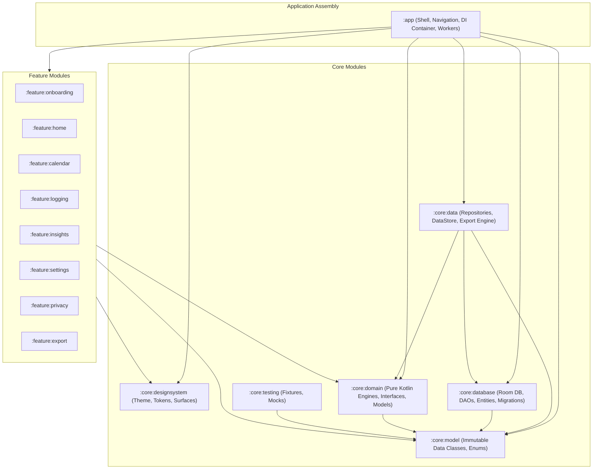
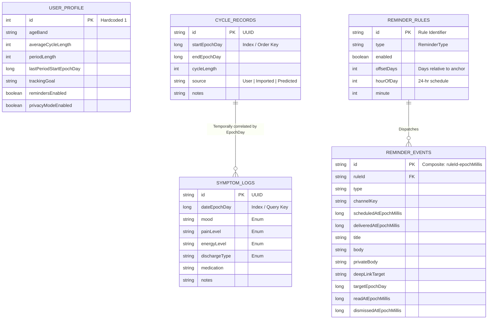
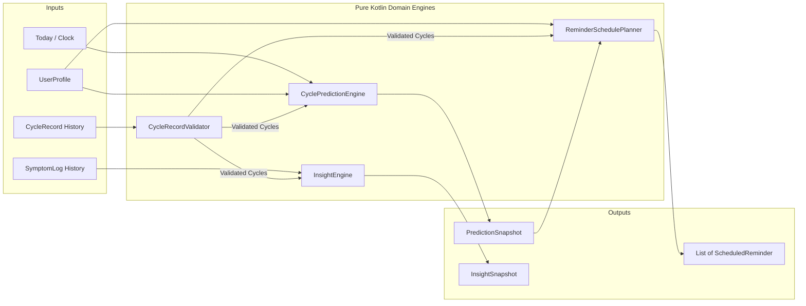
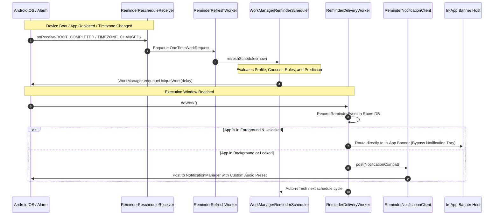
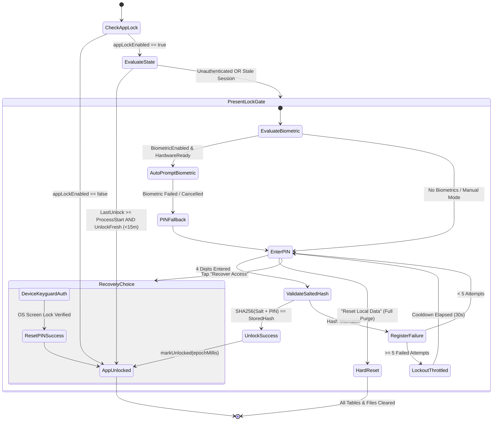

# CycleCare: System Design & Architecture Specification
**Document Version:** 1.0.0  
**Author:** Staff System Design Engineer  
**Status:** Approved / Production-Ready  
**Classification:** Engineering Architecture Document  

> ## ⛔ SUPERSEDED — 17 October 2026
>
> **Do not implement from this document.** It describes algorithm and notification v1, and specifies a cloud sync design that does not exist. Retained for history only.
>
> The header's **"Approved / Production-Ready"** status is itself an instance of the problem `CycleCare-Redesign-Docs/00-current-state-review.md` identifies — an unsupported self-assessment standing in for evidence. It was never true: at the time of writing the project had no network layer, untested migrations, a macrobenchmark that does not compile, and a broken migration test.
>
> **Current build contract:** `CycleCare-Redesign-Docs/` — read the `README.md` there first.
>
> ### What is wrong with this document
>
> | Section | Problem |
> |---|---|
> | §4.1 | Specifies the **v1** prediction engine. Verified defects: no interval is ever validated; outliers are deliberately retained; **no prediction range is produced at all** despite this document and the UI implying dated ranges; `confidenceLabel` is an untyped `String`; and `today` is never injected on the production path. Replaced by `11-prediction-engine.md`. |
> | §4.1 | Omits that `InsightEngine` reads the stored `cycleLength` while the prediction engine reads start-to-start gaps — so **the two disagree for the same user**, and production data may already contain that divergence. |
> | §4.2 | Irregularity is "flagged when **any** cycle deviates by ≥ 6 days" — one bad row relabels a user's entire history. |
> | §5.1 | States a **12-hour** `ReminderRefreshWorker` cadence. The code runs **1 day**. This was already stale when written. |
> | §5 | Says "hybrid WorkManager scheduling". **No `AlarmManager` exists in the project.** Time-sensitive reminders use `OneTimeWorkRequest.setInitialDelay`, which defers without bound under Doze. |
> | §5.2 | Foreground routing is described accurately, but omits that `setGroup()` is set with **no group summary**, that delivery is **not idempotent** on retry, and that `setPublicVersion()` is never called. |
> | §6 | Threat matrix assumes a privacy posture the shipped app does not uphold — AdMob and UMP are integrated and active. |
> | §10.1 | Describes an E2EE `SyncAdapter` protocol. **No such implementation exists.** `SyncAdapter` is a `NoOpSyncAdapter` returning the literal string `"Sync is not enabled in v1."` There is no network layer, HTTP client or serialization library in the project. |
> | §10.2 | On-device ML is not present, planned, or required. |
>
> ### What remains accurate
>
> §2.1 (module decomposition), §3.1 (Room as local source of truth), §4.3 (validation engine), §5.2 (foreground routing and channel sounds) and §7.1 (unidirectional data flow) describe the shipped code correctly. **The feature modules are clean** — all 10 screens hoist state through ViewModels; the state-mutation violations are confined to the app shell (`AppLockGate.kt`, `CycleCareApp.kt`).
>
> See `docs/architecture.md` for a brief module summary that remains accurate and does not contradict the current set.

<details>
<summary>Superseded content — original specification</summary>

---

## 1. Executive Summary & Architectural Vision

### 1.1 Problem Statement & Product Scope
CycleCare is an offline-first, privacy-hardened menstrual cycle, symptom, and reproductive wellness application for Android. Modern health applications often violate user trust by transmitting sensitive biometric, sexual health, and reproductive logs to remote cloud backends, exposing users to subpoena risks, corporate tracking, and targeted marketing. 

CycleCare solves this by executing **100% of its data ingestion, cycle prediction, trend analysis, report generation, and scheduling strictly on-device**.

```
+-------------------------------------------------------------------------------+
|                             CycleCare Zero-Cloud Core                         |
|                                                                               |
|   +--------------------+     +-------------------+     +------------------+   |
|   |   User Ingestion   | --> | Deterministic     | --> | Multi-Cycle      |   |
|   |   & Daily Logging  |     | Prediction Engine |     | Insight Engine   |   |
|   +--------------------+     +-------------------+     +------------------+   |
|             |                          |                         |            |
|             v                          v                         v            |
|   +--------------------+     +-------------------+     +------------------+   |
|   | Room SQLite DB     |     | WorkManager Local |     | On-Device Export |   |
|   | (Epoch-Day Store)  |     | Notification Hub  |     | (PDF / Markdown) |   |
|   +--------------------+     +-------------------+     +------------------+   |
+-------------------------------------------------------------------------------+
                                      |
                     [ Strict Architectural Firewall ]
                                      |
                                      v
+-------------------------------------------------------------------------------+
|                       External Services (Isolated Sandbox)                   |
|                                                                               |
|      +---------------------------+       +-----------------------------+      |
|      | Google UMP (Privacy/GDPR) |       | AdMob Banner / Interstitial |      |
|      +---------------------------+       +-----------------------------+      |
|      * Zero cycle records, symptoms, notes, or profile data transmitted.      |
+-------------------------------------------------------------------------------+
```

### 1.2 Core Architectural Axioms
1. **Zero-Backend Dependency (Offline-First):** All application workflows (onboarding, cycle logging, retrospective analysis, predictions, notifications) function continuously without network access.
2. **Strict Data Boundary & Airgap:** Advertising SDKs (Google AdMob / UMP) and diagnostics are strictly sandboxed. No reproductive health metrics, cycle dates, moods, or symptom logs ever cross into the ad or analytics boundaries.
3. **Deterministic & Explainable Domain Models:** Machine learning models running on remote cloud servers are rejected in favor of auditable, deterministic statistical algorithms (rolling 6-cycle average with variance-based confidence bounds).
4. **Defense-in-Depth Privacy:** Physical access to the device is guarded by a multi-layered local security gate (cryptographic PBKDF2/SHA-256 salted PIN, BiometricPrompt, keyguard credential recovery, brute-force throttling, and notification text obfuscation).
5. **Modular Decoupling:** Monolithic application patterns are prohibited. The codebase is organized into isolated Gradle modules enforcing Clean Architecture with unidirectional data flow (UDF).

---

## 2. System Context & Top-Level Architecture

### 2.1 Multi-Module Decomposition
The project adheres to Google's recommended Guide to App Architecture, divided across layer-specific and feature-specific compilation boundaries:



### 2.2 Compilation Layer Roles & Boundaries

| Module | Purpose | Allowed Dependencies | Prohibited Dependencies |
| :--- | :--- | :--- | :--- |
| `:core:model` | Universal immutable data classes, domain enums, value objects. | Pure Kotlin standard library, `java.time`. | Android SDK, Room, UI, Coroutines. |
| `:core:domain` | Pure business logic, prediction algorithms, validation rules, repository interfaces. | `:core:model`, Kotlin Coroutines `Flow`. | Android framework (`Context`), Room, Compose. |
| `:core:database` | Room database definition, SQLite DAOs, database migrations, persistence entities. | `:core:model`, AndroidX Room, SQLite. | Compose UI, Business Engines, Presentation. |
| `:core:data` | Repository implementations, Preferences DataStore, PDF/Markdown exporters. | `:core:model`, `:core:domain`, `:core:database`, DataStore. | Jetpack Compose, UI Views. |
| `:core:designsystem`| Compose UI tokens, theme, typography, shapes, design preview scaffolding. | Compose Material 3, AndroidX Core. | Database, Repositories, Domain Engines. |
| `:feature:*` | Independent functional UI surfaces (screens, ViewModels, UI state definitions). | `:core:model`, `:core:domain`, `:core:designsystem`, Compose. | Direct database access, peer `:feature:*` modules. |
| `:app` | Application subclass, AppContainer DI wiring, WorkManager, Navigation graph. | All `:feature:*` and `:core:*` modules, Firebase, AdMob. | None (Top-level assembler). |

---

## 3. Data Architecture & Persistence Engineering

### 3.1 Relational Storage: Room Database
Primary relational storage is managed by `CycleCareDatabase` (SQLite wrapper via AndroidX Room), configured with `exportSchema = true` and tracked database migrations.



#### Deterministic Storage Design:
- **Epoch-Day Representation (`Long`):** All dates (`LocalDate`) are normalized to epoch days (`LocalDate.toEpochDay()`). This avoids ISO-8601 string parsing overhead, guarantees index sortability, and eliminates timezone displacement bugs during calendar queries.
- **Fail-Safe Enum Deserialization:** Raw database strings are safely parsed through `parseEnumSafely<T>()`. If an unknown enum value is encountered (e.g. from schema changes), the system logs an event to `AppLogger` and falls back gracefully to a non-null default without crashing the app.

### 3.2 Schema Migrations & Integrity (`migration1To2`)
The database schema evolved from v1 to v2 to introduce granular reminder offsetting, late-period alerts, and dedicated notification delivery logging:

```sql
-- Migration 1 -> 2 Strategy:
-- 1. Create reminder_rules_new with signed offsetDays
CREATE TABLE IF NOT EXISTS `reminder_rules_new` (
    `id` TEXT NOT NULL,
    `type` TEXT NOT NULL,
    `enabled` INTEGER NOT NULL,
    `offsetDays` INTEGER NOT NULL,
    `hourOfDay` INTEGER NOT NULL,
    `minute` INTEGER NOT NULL,
    PRIMARY KEY(`id`)
);

-- 2. Transform legacy rules and migrate historical records
INSERT INTO reminder_rules_new (id, type, enabled, offsetDays, hourOfDay, minute)
SELECT 
    CASE WHEN type = 'OvulationEstimate' AND id = 'OvulationEstimate' THEN 'FertileWindowStart' ELSE id END,
    CASE WHEN type = 'OvulationEstimate' THEN 'FertileWindowStart' ELSE type END,
    enabled,
    CASE WHEN type = 'PeriodPrep' THEN -daysBefore ELSE 0 END,
    hourOfDay,
    minute
FROM reminder_rules;

DROP TABLE reminder_rules;
ALTER TABLE reminder_rules_new RENAME TO reminder_rules;

-- 3. Create reminder_events audit and inbox table
CREATE TABLE IF NOT EXISTS `reminder_events` (
    `id` TEXT NOT NULL,
    `ruleId` TEXT NOT NULL,
    `type` TEXT NOT NULL,
    `channelKey` TEXT NOT NULL,
    `scheduledAtEpochMillis` INTEGER NOT NULL,
    `deliveredAtEpochMillis` INTEGER NOT NULL,
    `title` TEXT NOT NULL,
    `body` TEXT NOT NULL,
    `privateBody` TEXT NOT NULL,
    `deepLinkTarget` TEXT NOT NULL,
    `targetEpochDay` INTEGER,
    `readAtEpochMillis` INTEGER,
    `dismissedAtEpochMillis` INTEGER,
    PRIMARY KEY(`id`)
);
```

### 3.3 Key-Value Storage: Jetpack DataStore Preferences
DataStore (`cyclecare_prefs`) is reserved for low-cardinality, high-frequency security parameters and channel configurations:
- `pin_hash`: Salted SHA-256 hash string.
- `pin_salt`: 16-byte cryptographically secure random hex string generated via `SecureRandom`.
- `last_unlock_epoch_millis`: Timestamp of the most recent PIN or Biometric authorization.
- `app_lock_enabled`, `biometric_enabled`: Security enforcement flags.
- `hide_notification_preview`: Notification masking flag.
- Dynamic reminder channel configuration (`enabled`, `sound_enabled`, `sound_preset`, `vibration_enabled`).

### 3.4 Local Disaster Recovery & Export Subsystem
- **Full App Reset (`AppResetRepository`):** Executes an atomic teardown:
  1. Room database: `database.clearAllTables()`.
  2. File storage: `context.filesDir/exports` recursively deleted.
  3. DataStore: `preferences.clear()`.
  4. SharedPreferences: Notification prompt history wiped.
- **On-Device Exporters (`LocalExportRepository`):**
  - **Markdown Exporter:** Generates structured, human-readable `.md` wellness dossiers.
  - **PDF Exporter:** Uses Android's low-overhead native `PdfDocument` and `Paint` engine on `Dispatchers.IO` to write 595x842pt paginated documents. Shared externally via a private `FileProvider` (`com.cyclecare.tracker.fileprovider`).

---

## 4. Core Algorithmic & Domain Engines



### 4.1 Deterministic Cycle Prediction Engine (`CyclePredictionEngine`)
The prediction engine avoids unpredictable neural network heuristics in favor of deterministic mathematical models:

1. **Cycle Anchor Selection:**
   $$\text{Anchor Date} = \max(\text{CycleRecord.startDate}) \quad \text{or} \quad \text{UserProfile.lastPeriodStart}$$
2. **Rolling Average Interval:**
   $$\Delta_{\text{rolling}} = \text{round}\left( \frac{1}{K} \sum_{i=1}^{K} (\text{startDate}_{i+1} - \text{startDate}_i) \right), \quad K = \min(N, 6)$$
3. **Next Predicted Period:**
   $$\text{NextPeriodDate} = \text{Anchor Date} + \Delta_{\text{rolling}}$$
4. **Ovulation & Fertile Window Estimation:**
   $$\text{OvulationDate} = \text{NextPeriodDate} - 14 \text{ days}$$
   $$\text{FertileWindow} = [\text{OvulationDate} - 4 \text{ days}, \; \text{OvulationDate} + 1 \text{ day}]$$
5. **Variance-Based Confidence Scoring:**
   $$\text{Mean Absolute Deviation (MAD)} = \frac{1}{K} \sum_{i=1}^K \left| (\text{startDate}_{i+1} - \text{startDate}_i) - \Delta_{\text{rolling}} \right|$$
   - $K < 2$: `Baseline estimate`
   - $\text{MAD} \le 2.0$: `High confidence estimate`
   - $2.0 < \text{MAD} \le 5.0$: `Moderate confidence estimate`
   - $\text{MAD} > 5.0$: `Lower confidence estimate`
6. **Past-Due / Overdue Semantics:**
   When $\text{NextPeriodDate} < \text{Today}$, `daysUntilNextPeriod` transitions to negative integers without capping or artificial clamping, allowing the UI to present continuous overdue tracking.

### 4.2 Comprehensive Multi-Cycle Insight Engine (`InsightEngine`)
Processes historical cycle intervals and symptom logs over an active window to synthesize statistical patterns:
- **Irregularity Detection:** Flagged when any cycle in the history deviates from the rolling average by $\ge 6 \text{ days}$.
- **Temporal Phase Correlation:**
  - **Period Phase:** Filters symptoms occurring between `startDate` and `endDate`. Computes the modal pain level, dominant energy state, and prevalent mood.
  - **Fertile Window Phase:** Filters symptoms logged in the calculated fertile range ($[\text{Ovulation} - 4, \text{Ovulation} + 1]$). Correlates peak discharge types (`EggWhite`, `Creamy`) and energy swings.
- **Natural Language Narrative Generator:** Synthesizes an automated, humanized summary (e.g., *"Recent history shows 27 to 29 day cycles across 5 logged cycles. Stable mood shows up most often, with light pain appearing most frequently..."*).

### 4.3 Validation Engine (`CycleRecordValidator`)
Guarantees database consistency before writes:
- Validates that period end date $\ge$ period start date.
- Enforces maximum realistic bleeding length ($\le 14 \text{ days}$).
- Disallows overlapping period intervals across records.
- Verifies non-negative cycle lengths.

---

## 5. Background Execution & Distributed Notification System



### 5.1 Hybrid WorkManager Scheduling
To balance battery consumption against precision:
- **`PeriodicWorkRequest` (12-hour cadence):** `ReminderRefreshWorker` runs periodically with `ExistingPeriodicWorkPolicy.KEEP` to re-align schedules against the passage of time.
- **`OneTimeWorkRequest` (Targeted Delays):** `WorkManagerReminderScheduler` calculates the exact duration $\Delta t = \text{TargetTime} - \text{Now}$ and enqueues a uniquely tagged `ReminderDeliveryWorker` (`ExistingWorkPolicy.REPLACE`).
- **Broadcast Invalidation:** `ReminderRescheduleReceiver` triggers instant schedule re-calculation on:
  - `android.intent.action.BOOT_COMPLETED`
  - `android.intent.action.MY_PACKAGE_REPLACED`
  - `android.intent.action.TIMEZONE_CHANGED`
  - `android.intent.action.TIME_SET`

### 5.2 Dynamic Foreground Routing & Privacy Obfuscation
When `ReminderDeliveryWorker` fires:
1. **Foreground Awareness (`AppVisibilityObserver`):** If the user is actively inside the app and the screen is unlocked, the notification tray is skipped; the event is routed directly to an in-app animated banner (`ReminderBannerHost`).
2. **Notification Privacy Masking:**
   - **Full Detail:** `"Period in 2 days" / "Your period is predicted to start soon based on your 28-day cycle."`
   - **Obfuscated (When `hideNotificationPreview = true`):** `"Cycle reminder" / "Open CycleCare for today's wellness update."`
3. **Dedicated Audio Channels:**
   - `CycleAlerts` $\rightarrow$ Gentle Bell (`gentle_bell.ogg`)
   - `FertilityAlerts` $\rightarrow$ Water Drop (`water_drop.ogg`)
   - `DailyCheckIn` $\rightarrow$ Soft Chime (`soft_chime.ogg`)

---

## 6. Security, Threat Modeling & Access Control

### 6.1 Threat Model Matrix

| Threat Vector | Attack Scenario | Architectural Countermeasure |
| :--- | :--- | :--- |
| **Physical Device Seizure** | Attacker opens app on unlocked phone to view reproductive history. | **AppLock Gate:** 4-digit salted PIN gate and `BiometricPrompt` with session expiration. |
| **Lock-Screen Peeking** | Bystanders or family members read notification alerts on lock screen. | **Notification Obfuscation:** Default redaction of titles/bodies to generic wellness text. |
| **OS Cloud Backup Extraction** | Cloud backup (Google Drive) copies unencrypted SQLite DB to remote servers. | **`android:allowBackup="false"`:** Explicitly disabled in Manifest; blocks ADB and cloud backup. |
| **Ad SDK Telemetry Snooping** | Third-party advertising libraries scrape app memory or local SQLite databases. | **Process Isolation & Pure Sandbox:** Zero database access granted to ad code; zero ad targeting IDs. |
| **Brute-Force PIN Attack** | Rapid computerized or manual PIN entry attempts. | **Exponential Throttling:** 5 consecutive failures triggers a mandatory 30-second hardware cooldown timer. |
| **Task Switcher Shoulder Surfing**| Health charts visible in the Android Recent Apps / Multitasking carousel. | **FLAG_SECURE Integration:** Window manager hides content from task thumbnails and screenshots. |

### 6.2 Authentication & Cryptographic Invariants



---

## 7. Presentation Layer & UI Architecture

### 7.1 Compose Architecture & Unidirectional Data Flow (UDF)
The presentation layer uses 100% Jetpack Compose with Material 3, following strict UDF:

```
    +-----------------------------------------------------------+
    |                     Compose Screen                        |
    +-----------------------------------------------------------+
               |                                     ^
       (User Intent / Events)              (Immutable UI State)
               v                                     |
    +-----------------------------------------------------------+
    |                        ViewModel                          |
    |  - Exposes: StateFlow<UiState>                            |
    |  - Uses: SavedStateHandle for process-death survival      |
    |  - Dispatches: Coroutine execution via viewModelScope     |
    +-----------------------------------------------------------+
               |                                     ^
       (Repository Call)                    (Flow Emitted Data)
               v                                     |
    +-----------------------------------------------------------+
    |                    Domain / Data Layer                    |
    +-----------------------------------------------------------+
```

### 7.2 Process Death & State Restoration
Every feature ViewModel accepts a `SavedStateHandle`. Key user interaction states (selected calendar dates, partial logging drafts, filter chips) are mirrored to saved state, surviving Android OS process termination under memory pressure.

### 7.3 Navigation & Deep-Linking Strategy
The navigation graph is orchestrated via Jetpack Navigation Compose (`AppNavHost`). Deep-link routing maps notification events to specific nested destinations:

| Route | Purpose | Key Sub-Routes | Deep Link Target |
| :--- | :--- | :--- | :--- |
| `home` | Main dashboard & status hero | `home/cycle-status`, `home/fertility-detail` | `ReminderDeepLinkTarget.Home` |
| `calendar` | Interactive cycle/ovulation grid | Date selection bottom-sheet | `ReminderDeepLinkTarget.Calendar` |
| `log` | Fast daily symptom/period logger | Date-stepper, chip selectors | `ReminderDeepLinkTarget.Log` |
| `insights` | Multi-cycle analytics & trends | `insights/cycle-trends`, `insights/symptom-patterns` | N/A |
| `settings` | Notification & privacy toggles | Reminder channel config, sound tester | N/A |
| `reminders` | Local notification history inbox | Notification card list, clear actions | `ReminderDeepLinkTarget.ReminderCenter` |
| `privacy` | Security lock, PIN, biometrics | PIN setup, reset modal | N/A |
| `export` | On-device report generator | Markdown and PDF generators | N/A |

---

## 8. Observability, Performance & Reliability

### 8.1 Performance Metrics & Macrobenchmark Coverage
The project includes a dedicated `:benchmark` module utilizing AndroidX Macrobenchmark:
- **Cold Start Benchmark (`startup_homeColdStart`):** Measures cold app startup time to the first interactive frame on the Home screen.
- **Frame Timing & Jank Benchmark (`calendar_openAndScroll`):** Simulates opening the calendar and executing rapid swipes to measure frame drops and 99th-percentile frame render times.
- **StrictMode Zero-Tolerance:** `StrictMode` is configured in debug builds to catch main-thread disk I/O, network leaks, and SQLite resource leaks.

### 8.2 Telemetry Abstraction & Crash Telemetry
To preserve privacy while retaining enterprise diagnostic capabilities, telemetry is wrapped in interface boundaries:
- `AppLogger`: Routes events to Android Logcat in debug, filtering PII.
- `CrashReporter`: Gracefully falls back to `NoOpCrashReporter` if `app/google-services.json` is missing, preventing build or runtime failures when Firebase is inactive.

---

## 9. Failure Modes, Edge Cases & Resilience Engineering

| Subsystem | Potential Failure Mode | Root Cause | Engineering Mitigation |
| :--- | :--- | :--- | :--- |
| **Storage** | SQLite DB corruption on ungraceful shutdown. | Battery drop or device crash during write. | SQLite WAL (Write-Ahead Logging) mode; atomic Room transactions; export capability allows user to preserve external backups. |
| **Notification** | Reminders fail to fire on OEM devices (Xiaomi, Huawei, Samsung). | Aggressive battery management killing background tasks. | WorkManager fallback chains; broadcast listeners re-aligning on system wake; optional exact alarm compatibility path. |
| **Security** | Forgotten PIN locks user out permanently. | User forgets 4-digit code. | **SecureAuth Recovery:** Verifies device lock (fingerprint/face/pattern/PIN) via Android `KeyguardManager` to permit PIN reset without data loss. |
| **Security** | Attacker attempts PIN guessing. | Physical device access. | Cooldown lockout after 5 failures (30 seconds lock delay) enforced via persistent state. |
| **Predictions** | Extreme irregular cycle lengths break date math. | Illness, hormonal changes, or PCOS causing 90+ day cycles. | Rolling median/average limits sample to last 6 cycles; does not trim or crash on high variance; transitions to explicit "Lower confidence estimate". |
| **Ad Sandbox** | Ad network downtime or network offline. | Device has no internet connectivity. | Native fallback container hides ad slot completely; app functionality remains 100% operational without layout jank. |

---

## 10. Future Extensibility & Architecture Roadmap

### 10.1 End-to-End Encrypted (E2EE) Sync Protocol (`SyncAdapter`)
While v1 is strictly local-first, the repository includes the `SyncAdapter` contract interface. A future v2 can implement zero-knowledge cloud synchronization:
- **Client-Side Key Derivation:** Argon2id or PBKDF2 derived from a user passphrase.
- **Envelope Encryption:** AES-256-GCM encryption of SQLite records prior to network dispatch.
- **Conflict-Free Replicated Data Types (CRDTs):** State-based CRDTs to resolve multi-device offline edit conflicts without server-side decryption.

### 10.2 On-Device Machine Learning (TFLite / MediaPipe)
Replacing deterministic rolling averages with an on-device TensorFlow Lite model trained on localized menstrual health datasets, predicting luteal phase defects and cycle irregularities entirely within the device sandbox.

---

## 11. Architectural Sign-Off & Verification Checklist

- [x] **Zero-Cloud Health Data Leakage:** Verified through code audit; no HTTP client dependencies in `:core:domain`, `:core:data`, `:core:database`.
- [x] **Clean Architecture Isolation:** Domain layer has zero Android framework dependencies.
- [x] **Room Migration Integrity:** `migration1To2` covered by unit and instrumentation tests.
- [x] **App Lock & Biometric Fallback:** Verified against `KeyguardManager` and `BiometricPrompt` APIs.
- [x] **StrictMode Compliance:** Main thread clean of Room queries and file writes.
- [x] **Macrobenchmark Scenarios:** Startup and scrolling benchmarks established.
- [x] **Figma Token Fidelity:** Material 3 color roles mapped to Figma specifications.

</details>
